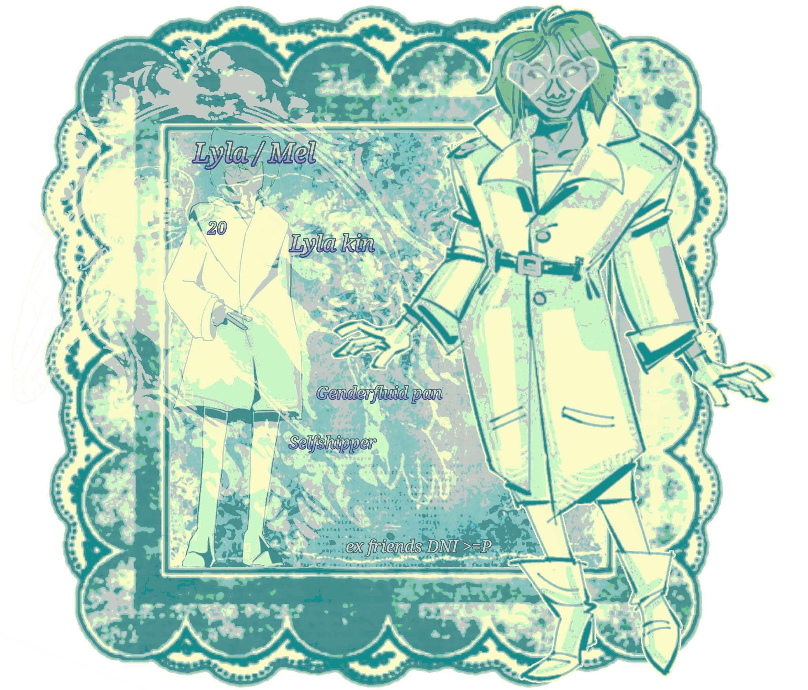

ㅤㅤㅤㅤㅤㅤ 

  
DNI: Racists, homo/transphobes, tiktok Christians, whitewashers, -18(unless I already know you), pedos, pro/darkshippers, dandy's world fans, HH/HB fans, Miguel O'hara haters, Gwen Stacy haters. TI: spiderdads, doubles ᴅᴏᴜ</detail> 
<strong> DNI/THIN ICE </strong>

  
I have severe depression and anxiety disorder which means I often have dni or dniuf I can also be quiet and afk because I don't have motivation, I have hard time understanding things and I suck at wording things (sorry about that I promise I will work on it better but it might take time because I have learning disability) I can be rude sometimes (again I'm sorry if I am and I will fix my attitude and I promise to always apologize), I sometimes talk about Miguel O'hara way too much ^^" (you can tell me to shut up I won't get offended DW)</detail> 
<strong> BYI </strong>

I have already apologized to DOMO/COAL and they have seen it.
they asked my friend to change there font because they couldn't read it because they're disabled and I acted very wrong and not because they're disabled, not to mock it (not at all) but because my friend did change so easily and that reminded me how I used to change myself all the time because to please others. I answered with "the message below me pmo" but I worded it so wrong and I never meant to harm Domo or mock they're struggle. I have a depressive episode right now and during that incident I had it too and I can be angry during my episode and not think straight and I know that I should've acted better than this I know it clearly. I feel guilty for my lack of sense and I took action and I apologized and not because I was scared but because I know I have to, to let them know that my intentions wasn't meant to be harmful and that I'm sorry. I have and still am struggling with learning things, writing things and understanding things. I used to be in a small class with disabled kids and struggling kids at school because of it I even ended up repeating a year and I'm trying to be better than this and think twice now and I will get my messages re-watched now.. and that what happened between me and Domo doesn't include you people who have been harassing me daily, mocking me and sending death threats, I have committed already and I don't want to go through that again but I am very sensitive to death threats so I'm Kindly asking you people to stop that, please.
